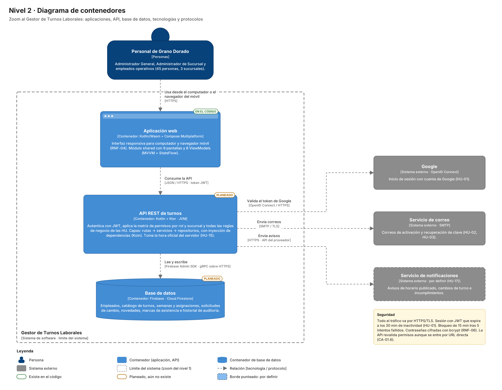
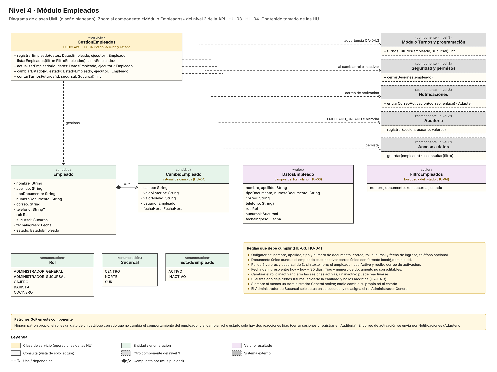
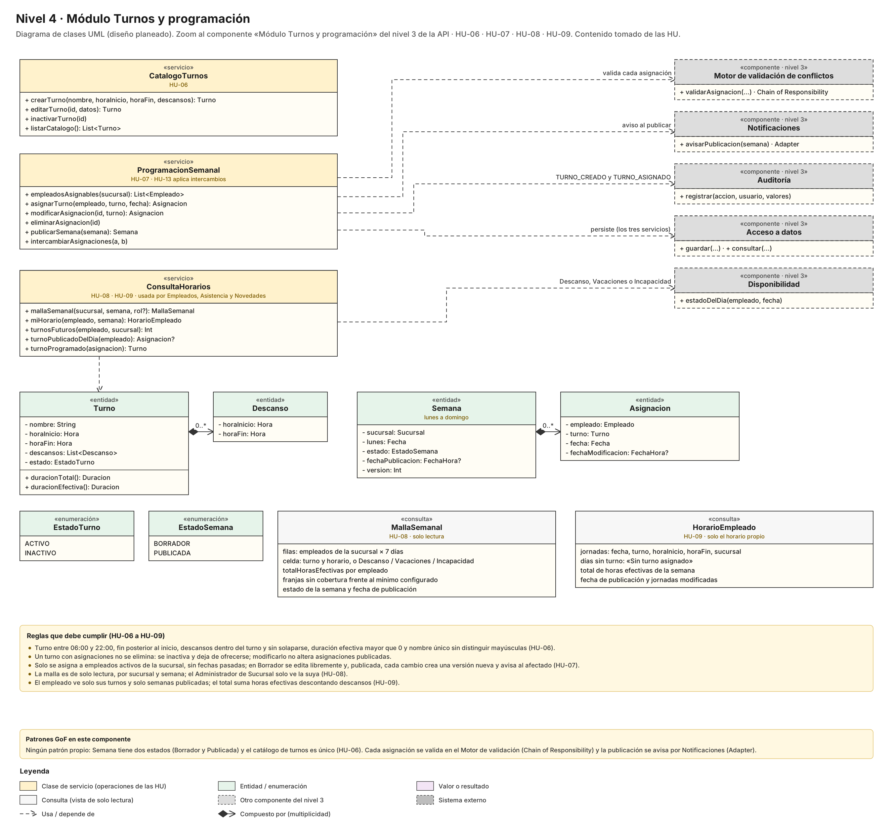
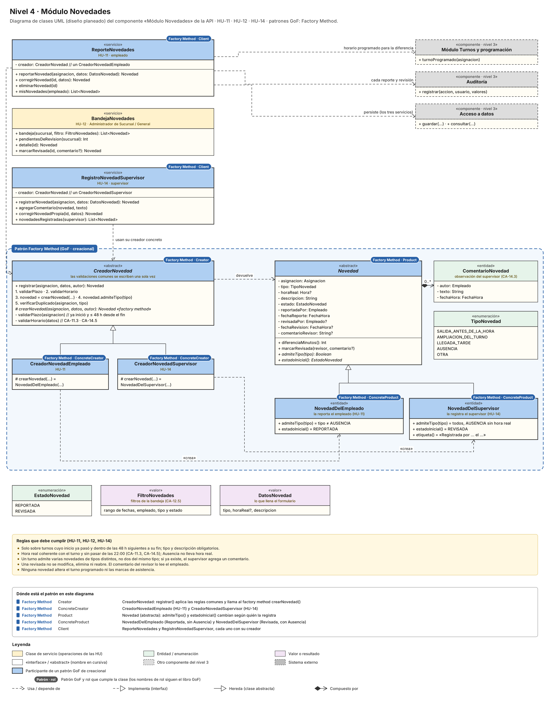
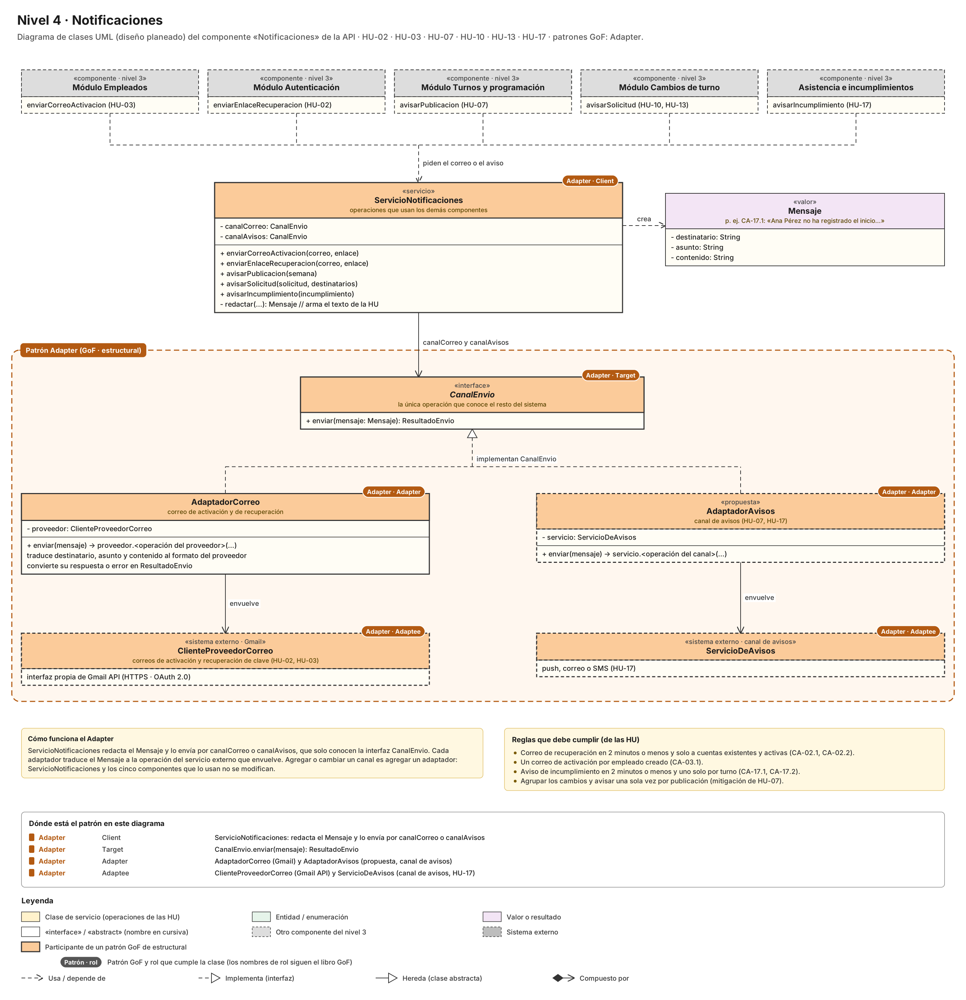

# Laboratorio Modelo C4 · Gestor de Turnos Laborales

## 1. C4 Nivel 1 - Contexto

## 2. C4 Nivel 2 - Contenedores

## 3. C4 Nivel 3 - Componentes

### 3.1 API REST de turnos

| Componente | Historias de usuario |
|---|---|
| Seguridad y permisos | HU-01, RNF-02 |
| Módulo Autenticación | HU-01, HU-02 |
| Módulo Empleados | HU-03, HU-04 |
| Módulo Turnos y programación | HU-06, HU-07, HU-08, HU-09 |
| Motor de validación de conflictos | HU-07, HU-10, HU-13 |
| Disponibilidad | Requerido por HU-07, HU-08, HU-15, HU-17 |
| Módulo Asistencia e incumplimientos | HU-15, HU-16, HU-17 |
| Módulo Novedades | HU-11, HU-12, HU-14 |
| Módulo Cambios de turno | HU-10, HU-13 |
| Planificador de tareas | HU-10, HU-15, HU-17 |
| Auditoría | Todas |
| Notificaciones | HU-02, HU-03, HU-07, HU-10, HU-13, HU-17 |
| Acceso a datos | Todas |

## 4. C4 Nivel 4 - Código

### 4.1 Módulo Empleados

**Diagrama**

**Patrón GoF utilizado**

**Patrón:** no aplica un patrón propio.

**Justificación:** el rol es un dato de un catálogo cerrado que no cambia el comportamiento del empleado, y al cambiar el rol o el estado solo hay dos reacciones fijas (cerrar sesiones y registrar en Auditoría). El correo de activación se envía por el componente Notificaciones, que aplica Adapter.

**Historias de usuario relacionadas**

- **HU-03 Creación de empleados:** `GestionEmpleados.registrarEmpleado()` con `DatosEmpleado` y la entidad `Empleado`.
- **HU-04 Actualización de empleados:** `listarEmpleados()`, `actualizarEmpleado()` y `cambiarEstado()`, con `FiltroEmpleados` y el historial `CambioEmpleado`.

### 4.2 Módulo Turnos y programación

**Diagrama**

**Patrón GoF utilizado**

**Patrón:** no aplica un patrón propio.

**Justificación:** `Semana` tiene solo dos estados (Borrador y Publicada) y el catálogo de turnos es único. Cada asignación se valida en el Motor de validación (Chain of Responsibility) y la publicación se avisa por Notificaciones (Adapter).

**Historias de usuario relacionadas**

- **HU-06 Creación de turnos:** `CatalogoTurnos`, con `Turno` y `Descanso`.
- **HU-07 Asignación de turnos:** `ProgramacionSemanal`, con `Semana` y `Asignacion`.
- **HU-08 Horarios por sucursal:** `ConsultaHorarios.mallaSemanal()` y la consulta `MallaSemanal`.
- **HU-09 Ver horario asignado:** `ConsultaHorarios.miHorario()` y la consulta `HorarioEmpleado`.

### 4.3 Módulo Autenticación

**Diagrama**

**Patrón GoF utilizado**

**Patrón:** no aplica un patrón propio.

**Justificación:** Google es el único proveedor externo de inicio de sesión, así que no hay proveedores que intercambiar. El enlace de recuperación se envía por Notificaciones (Adapter).

**Historias de usuario relacionadas**

- **HU-01 Login:** `InicioSesion`, con `Cuenta`, `IntentoInicioSesion` y `ResultadoInicioSesion`.
- **HU-02 Recuperación de clave:** `RecuperacionClave`, con `EnlaceRecuperacion` y `PoliticaContrasena`.

### 4.4 Disponibilidad

**Diagrama**

**Patrón GoF utilizado**

**Patrón:** no aplica un patrón propio.

**Justificación:** es una consulta de solo lectura. `ConsultaDisponibilidad` alimenta el eslabón `ReglaDiaDisponible` del Motor de validación (Chain of Responsibility).

**Historias de usuario relacionadas**

- **HU-07 Asignación de turnos:** el Motor rechaza asignar en un día no disponible.
- **HU-08 Horarios por sucursal:** la malla marca el día no disponible.
- **HU-15 Marcar asistencia** y **HU-17 Notificaciones de incumplimientos:** no se marca ni se evalúa ese día.

### 4.5 Motor de validación de conflictos

**Diagrama**

**Patrón GoF utilizado**

**Patrón:** Chain of Responsibility.

**Justificación:** antes de asignar o intercambiar un turno hay que aplicar siete reglas en orden, cada una con su propio mensaje, y la primera que falla detiene la validación. Con una cadena, cada regla es una clase independiente que se puede agregar, quitar o reordenar sin tocar las demás, y las mismas reglas sirven para asignar e intercambiar. Se reconoce en `ReglaValidacion` (Handler) y su autoasociación «siguiente 0..1», en las siete reglas que heredan de ella (ConcreteHandler) y en `MotorValidacion` (Client), que arma las cadenas.

**Historias de usuario relacionadas**

- **HU-07 Asignación de turnos:** `cadenaAsignacion` valida cada asignación.
- **HU-10 Solicitar cambio de turno:** `cadenaIntercambio` filtra los turnos elegibles.
- **HU-13 Aprobar cambios de turno:** la misma cadena revalida el intercambio al aprobar.

### 4.6 Módulo Asistencia e incumplimientos

**Diagrama**

**Patrón GoF utilizado**

**Patrón:** no aplica un patrón propio.

**Justificación:** la secuencia de marcas se resuelve con la enumeración `EstadoJornada` y una tabla de transiciones en `siguienteMarca()`. Los avisos de incumplimiento se envían por Notificaciones (Adapter).

**Historias de usuario relacionadas**

- **HU-15 Marcar asistencia:** `MarcacionEmpleado` y la entidad `Marca`.
- **HU-16 Asistencia (supervisor):** `RegistroSupervisor`.
- **HU-17 Notificaciones de incumplimientos:** `Incumplimientos` y la entidad `Incumplimiento`.

### 4.7 Módulo Novedades

**Diagrama**

**Patrón GoF utilizado**

**Patrón:** Factory Method.

**Justificación:** una novedad se registra con el mismo proceso, pero nace distinta según quién la registra: la del empleado no admite el tipo Ausencia y nace Reportada; la del supervisor admite Ausencia y nace Revisada. Factory Method deja las validaciones comunes en un solo lugar y permite que cada variante cree su propio objeto. Se reconoce en `CreadorNovedad` (Creator) con el método de creación `crearNovedad()`, en `CreadorNovedadEmpleado` y `CreadorNovedadSupervisor` (ConcreteCreator) y en `Novedad` con `NovedadDelEmpleado` y `NovedadDelSupervisor` (Product y ConcreteProduct), unidos por las dependencias «crea».

**Historias de usuario relacionadas**

- **HU-11 Reportar novedades:** `ReporteNovedades` usa `CreadorNovedadEmpleado`.
- **HU-12 Ver novedades:** `BandejaNovedades`.
- **HU-14 Novedades de empleado:** `RegistroNovedadSupervisor` usa `CreadorNovedadSupervisor`.

### 4.8 Módulo Cambios de turno

**Diagrama**

**Patrones GoF utilizados**

**Patrón:** State.

**Justificación:** la solicitud de cambio pasa por ocho estados y la misma acción produce resultados distintos según el estado (por ejemplo, rechazar en Solicitada o en Aceptada por el compañero). State evita repetir esos condicionales: cada estado es una clase que decide qué acciones permite y a qué estado lleva. Se reconoce en `SolicitudCambio` (Context), la interfaz `EstadoSolicitud` (State) y los estados concretos; los cinco estados terminales heredan de `EstadoFinal`, que no permite ninguna acción.

**Patrón:** Observer.

**Justificación:** cada cambio de estado debe avisar a la persona que corresponde y quedar registrado en Auditoría. Observer permite que la solicitud notifique una sola vez y que cada reacción sea independiente. Se reconoce en `PublicadorCambiosSolicitud` (Publisher), la interfaz `ObservadorSolicitud` (Subscriber) y los observadores `AvisosSolicitud` y `RegistroAuditoriaSolicitud`.

**Historias de usuario relacionadas**

- **HU-10 Solicitar cambio de turno:** `SolicitudesCambio`.
- **HU-13 Aprobar cambios de turno:** `AprobacionCambios`.

### 4.9 Planificador de tareas

**Diagrama**

**Patrón GoF utilizado**

**Patrón:** no aplica un patrón propio.

**Justificación:** el planificador llama a operaciones fijas de Asistencia y de Cambios de turno. Al vencer una solicitud, `SolicitudCambio.vencer()` aplica State y notifica a sus observadores (Observer).

**Historias de usuario relacionadas**

- **HU-10 Solicitar cambio de turno:** `vencerSolicitudes()`.
- **HU-15 Marcar asistencia:** `marcarPendientesDeCierre()`.
- **HU-17 Notificaciones de incumplimientos:** `generarIncumplimientosDeInicio()` y `avisarTurnosSinMarcaDeFin()`.

### 4.10 Notificaciones

**Diagrama**

**Patrón GoF utilizado**

**Patrón:** Adapter.

**Justificación:** cinco componentes envían correos o avisos a través de servicios externos (Gmail y el canal de avisos), cuyas interfaces no coinciden con la del sistema. El adaptador traduce el mensaje del sistema a la interfaz de cada servicio, de modo que cambiar o agregar un canal no obliga a modificar los componentes que avisan. Se reconoce en `ServicioNotificaciones` (Client), la interfaz `CanalEnvio` (Target), `AdaptadorCorreo` y `AdaptadorAvisos` (Adapter) y los servicios externos `ClienteProveedorCorreo` y `ServicioDeAvisos` (Adaptee).

**Historias de usuario relacionadas**

- **HU-02 Recuperación de clave:** `enviarEnlaceRecuperacion()`.
- **HU-03 Creación de empleados:** `enviarCorreoActivacion()`.
- **HU-07 Asignación de turnos:** `avisarPublicacion()`.
- **HU-10 Solicitar cambio de turno** y **HU-13 Aprobar cambios de turno:** `avisarSolicitud()`.
- **HU-17 Notificaciones de incumplimientos:** `avisarIncumplimiento()`.

